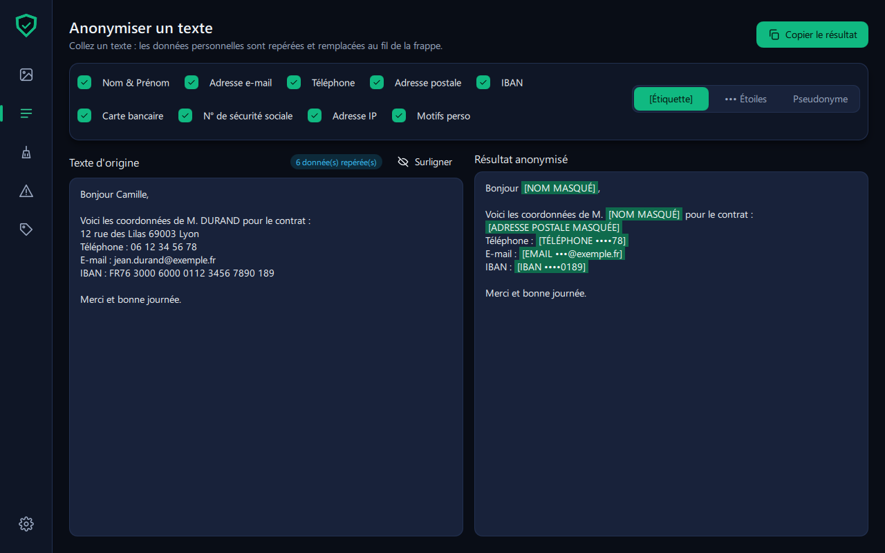
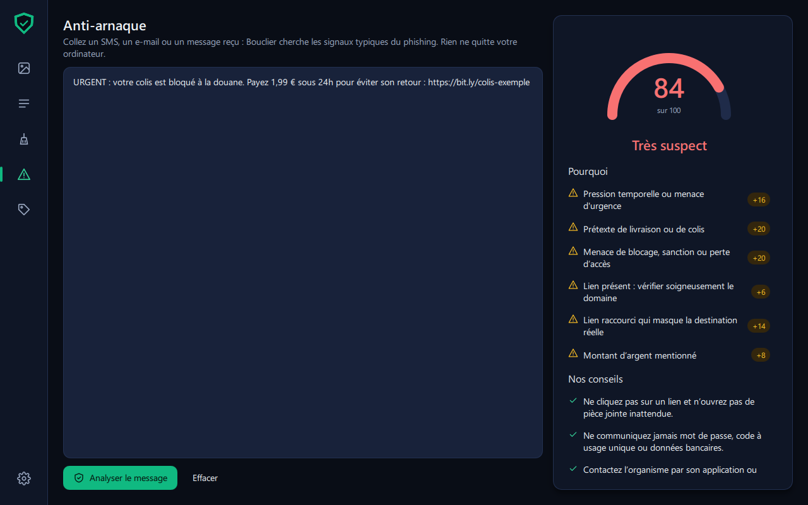

<div align="center">


# Bouclier

**Masquez vos données personnelles avant de partager une image, un texte ou un document.**<br>
Tout se passe sur votre ordinateur : aucun compte, aucune publicité, aucune télémétrie.

[](https://github.com/rudysooo/bouclier/actions/workflows/tests.yml)
[](https://github.com/rudysooo/bouclier/releases/latest)
[](LICENSE)

### [⬇️ Télécharger pour Windows](https://github.com/rudysooo/bouclier/releases/latest/download/Bouclier_Installer.exe)

Un projet [Polaether](https://polaether.polaether.workers.dev/) · Interface en français, anglais et espagnol

</div>



## Ce que fait Bouclier

| Outil | Ce qu'il fait |
|---|---|
| **Images** | Repère le texte sensible (OCR) et les visages, puis les masque : noir, flou ou mosaïque. Zones à la souris, comparaison avant/après, annuler/rétablir. La copie enregistrée n'a plus de métadonnées (EXIF, GPS). |
| **Texte** | Remplace noms, adresses, e-mails, téléphones, IBAN, cartes, numéros de sécurité sociale et adresses IP par une étiquette, des étoiles ou un pseudonyme. |
| **Nettoyeur de fichiers** | Retire les métadonnées des images, PDF et documents Word, Excel, PowerPoint. |
| **Anti-arnaque** | Note un SMS ou un e-mail suspect (français et anglais) et explique pourquoi. |
| **Motifs et mots-clés** | Ajoutez vos propres mots et expressions à toujours masquer. |



## Installation (Windows)

1. [Téléchargez `Bouclier_Installer.exe`](https://github.com/rudysooo/bouclier/releases/latest/download/Bouclier_Installer.exe).
2. Double-cliquez dessus. Windows peut afficher « Windows a protégé votre ordinateur », car l'installateur n'est pas signé numériquement : cliquez sur **Informations complémentaires**, puis **Exécuter quand même**.
3. Pour la lecture automatique du texte dans les images, ouvrez Bouclier et cliquez sur **Installer / Réparer automatiquement**.

Vous pouvez comparer l'empreinte SHA-256 indiquée sur la [page de la version](https://github.com/rudysooo/bouclier/releases/latest) avec celle de votre fichier :

```powershell
Get-FileHash Bouclier_Installer.exe
```

### La lecture du texte (OCR)

Elle repose sur [Tesseract](https://github.com/tesseract-ocr/tesseract), un logiciel libre installé à part. Son installation est **le seul moment où Bouclier télécharge quelque chose**, et uniquement à votre demande. Sans OCR, Bouclier vous le dit clairement : seuls les visages et vos zones tracées à la main sont masqués.

## À lire avant de partager un document

La détection automatique **peut oublier** des données (un prénom rare écrit seul, un texte mal lu sur une photo, un visage de profil) ou masquer un mot de trop. **Relisez toujours le résultat.**

- Bouclier ne modifie jamais votre fichier d'origine : il enregistre une copie.
- Le nettoyeur produit la **version finale** d'un document Office : modifications acceptées, texte supprimé retiré, commentaires effacés.
- Les objets intégrés qu'il ne sait pas nettoyer sont signalés « À vérifier ».
- Image à plusieurs pages : le nettoyeur les garde toutes ; le masquage ne traite que la première et vous prévient.

## Depuis le code source

Python 3.10 ou plus récent (Windows ; macOS et Linux non testés).

```bash
git clone https://github.com/rudysooo/bouclier.git
cd bouclier
pip install -r requirements.txt
python -m bouclier
```

Sous Linux, installez aussi `libxcb-cursor0` et `libegl1` si Qt ne démarre pas.

### Lancer les tests

```bash
pip install -r requirements.txt -r requirements-dev.txt
python -m pytest
```

### Construire l'installateur

Avec [Inno Setup](https://jrsoftware.org/isdl.php) 6 ou 7, lancez `installateur\CONSTRUIRE_INSTALLATEUR.bat`. Résultat : `dist_installateur\Bouclier_Installer.exe`.

### Organisation

```
bouclier/        moteur : OCR, détection, masquage, nettoyage, anti-arnaque
bouclier/ui/     interface Qt / QML
installateur/    construction de l'installateur Windows
tests/           tests automatiques
docs/            captures d'écran
Installer.bat    installation depuis le code source (Windows)
```

## Signaler un problème

Ouvrez un [ticket](https://github.com/rudysooo/bouclier/issues). **N'y joignez jamais un document contenant de vraies données personnelles.**

## Sécurité

Une donnée qui aurait dû disparaître reste lisible ? Voyez [comment la signaler](SECURITY.md).

## Licence

[MIT](LICENSE) © Polaether. Bouclier utilise Qt / PySide6 (LGPL), Pillow, OpenCV, pypdf, pytesseract et Tesseract, chacun sous sa propre licence.
